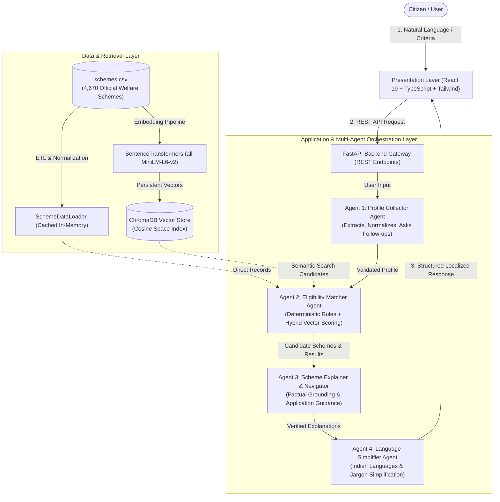
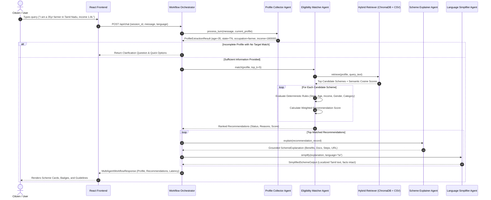

# BenefitBridge AI: System Architecture & Technical Specifications

## 1. Problem Statement & Motivation
Government welfare programs in India span over 900 Central schemes and 4,000+ State/UT schemes across education, healthcare, agriculture, housing, and social security. Despite substantial public funding, vulnerable citizens often fail to discover or access eligible benefits due to:
1. **Information Fragmentation**: Dispersed portals with disparate terminology and incompatible structures.
2. **Complex Eligibility Criteria**: High-dimensional, multi-parameter constraints (age limits, income ceilings, land ownership, caste category, domicile rules).
3. **Language Barriers**: Administrative jargon inaccessible to non-English speakers or rural citizens.
4. **Lack of Personalized Conversational Decision Support**: Portals offer static keyword lookup without guided eligibility verification.

**BenefitBridge AI** resolves this with a four-agent Retrieval-Augmented Generation (RAG) framework, coupling deterministic Python eligibility checking with SentenceTransformers vector search and grounded multilingual presentation.

---

## 2. Multi-Agent System Architecture

The architecture consists of three cohesive tiers: **Presentation Layer (React + Vite + Tailwind)**, **Application & AI Layer (FastAPI + Multi-Agent Orchestrator)**, and **Data & Retrieval Layer (ChromaDB + schemes.csv)**.

---

## 3. Four-Agent Operational Breakdown

| Agent | Responsibility | Core Mechanism | Deterministic vs LLM |
|-------|----------------|----------------|-----------------------|
| **1. Profile Collector** | Interactive conversational interview, profile extraction, validation, and targeted clarification questions. | Regex entity parser, synonym dictionaries (`TN` → `Tamil Nadu`, `Kisan` → `Farmer`), boundary checks ($0 \le \text{age} \le 120$). | Deterministic Python with optional Gemini extraction aid |
| **2. Eligibility Matcher** | Core technical engine: checks mandatory eligibility criteria, calculates semantic vector similarity, and scores recommendations. | Explicit Python rule evaluator for age, income ceiling, state, gender, social category, occupation; Hybrid ChromaDB retriever. | 100% Deterministic Python rules for eligibility verdicts |
| **3. Scheme Explainer & Navigator** | Plain-language synthesis of benefits, required documents, application steps, and verified official URLs. | Grounded strictly on retrieved scheme fields; explicitly disallows fabricating figures, documents, or URLs. | Official `google-genai` SDK with deterministic grounded template fallback |
| **4. Language Simplifier** | Translates and simplifies complex administrative descriptions into citizen-friendly Indian languages (Tamil, Hindi, Telugu, etc.). | Multilingual adaptation retaining exact scheme identifiers, official links, and numerical limits. | Gemini Multilingual with offline localized dictionary fallback |

---

## 4. End-to-End Workflow Sequence Diagram

---

## 5. Hybrid Retrieval and Recommendation Scoring Model

### 5.1 Deterministic Eligibility Evaluation
Each scheme's eligibility text is parsed into structured parameters (`min_age`, `max_age`, `max_income`, `allowed_states`, `allowed_genders`, `allowed_categories`, `target_occupations`, `requires_disability`).

Each criterion receives an auditable status:
- `pass`: Citizen attribute explicitly satisfies the condition.
- `fail`: Citizen attribute violates the condition (e.g. income exceeds ceiling or state mismatch).
- `unknown`: Scheme requires a condition, but citizen profile has not provided this information.
- `not_applicable`: Scheme has no restriction on this attribute.

**Eligibility Status Aggregate Classification**:
- `eligible_based_on_available_rules`: At least 2 mandatory criteria evaluated and all passed; 0 failures; 0 unknowns.
- `potentially_eligible`: At least 1 criterion passed; 0 explicit failures.
- `not_eligible_based_on_known_rules`: One or more explicit mandatory conditions failed.
- `insufficient_information`: Critical criteria unknown.

### 5.2 Recommendation Scoring Formula
Eligible schemes are ranked using a multi-factor weighted scoring algorithm:

$$\text{Score}(S_i, U) = \sum_{k=1}^{n} w_k \cdot f_k(S_i, U)$$

$$\sum_{k=1}^{n} w_k = 1.0$$

| Factor $f_k$ | Weight $w_k$ | Definition & Normalized Computation |
|--------------|--------------|-------------------------------------|
| **Eligibility Alignment** ($f_{\text{eligibility}}$) | **0.35** | Confirmed Eligible = 1.0; Potentially Eligible = 0.75; Insufficient Info = 0.40; Failed Criteria = 0.05 |
| **Semantic Similarity** ($f_{\text{semantic}}$) | **0.30** | Cosine similarity $1.0 - (\text{distance}/2.0)$ from ChromaDB vector retrieval |
| **State Specificity** ($f_{\text{state}}$) | **0.15** | Direct state match = 1.0; Central pan-India scheme = 0.85; Unspecified = 0.40 |
| **Occupation Relevance** ($f_{\text{occupation}}$) | **0.10** | Direct occupation sector alignment = 1.0; General = 0.50 |
| **Data Completeness** ($f_{\text{completeness}}$) | **0.10** | Presence of explicit benefits (0.50), documents (0.30), and application steps (0.20) |

> **Critical Safety Constraint**: If a mandatory condition deterministically fails ($f_{\text{eligibility}} \le 0.05$), the final score is heavily penalized ($\le 0.35$). High semantic similarity **never** overrides an explicit eligibility failure!

---

## 6. Security, Privacy & Responsible AI Safeguards

1. **API Key Security**: The `GEMINI_API_KEY` resides strictly in backend `.env` variables and is never transmitted to the frontend bundle.
2. **Citizen Privacy**: Profiles are maintained in transient in-memory session stores with a user-triggered reset button. No personal demographic details are stored in permanent databases.
3. **No Hallucination Mandate**: The Scheme Explainer Agent uses retrieved dataset rows as the sole factual source. Missing fields are explicitly marked as "unspecified in official record" rather than synthesized.
4. **Official URL Grounding**: Every scheme links directly to verified official government portals (`myscheme.gov.in`).
5. **Clear Disclaimer**: The application highlights that recommendations constitute automated decision support, not an official government certificate of entitlement.
